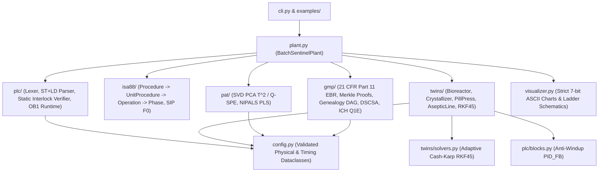
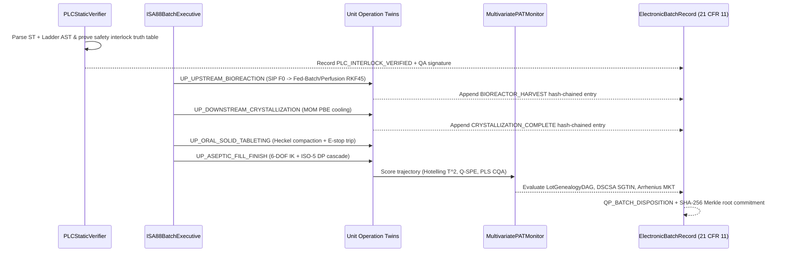

# BatchSentinel

[](https://github.com/ZengLLQ/batch-sentinel/actions/workflows/ci.yml)


**BatchSentinel** is a computational digital twin and regulatory verification platform for automated pharmaceutical manufacturing. It unifies an **IEC 61131-3 Structured Text & Ladder Logic PLC compiler, formal safety-interlock verifier, and deterministic OB1 scan-cycle runtime** with coupled **unit-operation physics twins** (fed-batch/perfusion bioreactor, Method-of-Moments cooling crystallizer, Heckel/Kawakita rotary tablet press, and 6-DOF aseptic fill-finish isolator robotics), **ISA-88 hierarchical procedural control**, **PAT multivariate statistical process control (PCA $T^2$/$Q$-SPE and NIPALS PLS)**, **FDA 21 CFR Part 11 cryptographic Electronic Batch Records (SHA-256 hash chains & Merkle proofs)**, **DSCSA GS1 SGTIN serialization**, and **ICH Q1A/Q1E Arrhenius cold-chain stability modeling**.

---

## Table of Contents

1. [System Architecture & Execution Flow](#1-system-architecture--execution-flow)
2. [Mathematical & Physical Formulations](#2-mathematical--physical-formulations)
3. [Subsystem Breakdown](#3-subsystem-breakdown)
4. [Installation & Quickstart](#4-installation--quickstart)
5. [CLI Reference](#5-cli-reference)
6. [SDK Walkthrough](#6-sdk-walkthrough)
7. [Quantitative Conservation & Convergence Benchmarks](#7-quantitative-conservation--convergence-benchmarks)
8. [7-Bit ASCII Terminal Visualization](#8-7-bit-ascii-terminal-visualization)
9. [Architectural Trade-offs, Assumptions & Known Limitations](#9-architectural-trade-offs-assumptions--known-limitations)

---

## 1. System Architecture & Execution Flow

### Module Dependency Topology



### Campaign Execution & Safety Interlock Lifecycle



---

## 2. Mathematical & Physical Formulations

### 2.1 Bioreactor Kinetics, Oxygen Mass Transfer & Thermal/pH Balances (`twins/bioreactor.py`)

The fed-batch and perfusion mammalian culture model integrates 11 coupled states via adaptive Cash-Karp RKF45:

$$\mu(S, C_{\text{O}_2}, L, T) = \mu_{\max} \left(\frac{S}{K_s + S + \frac{S^2}{K_{I,S}}}\right) \left(\frac{C_{\text{O}_2}}{K_{\text{O}_2} + C_{\text{O}_2}}\right) \left(\frac{K_{I,L}}{K_{I,L} + L}\right) \exp\!\left(-0.045\,(T - T_{\text{opt}})^2\right)$$

Liquid volume, biomass (with perfusion cell-retention factor $\eta_{\text{ret}} = 0.85$), glucose substrate, lactate (with anaerobic Pasteur shift $\psi_{\text{hyp}} = 1 + 3.5\max(0, 1 - C_{\text{O}_2}/1.5)$), recombinant mAb titer $P$, dissolved oxygen, broth temperature, and buffer pH evolve according to:

$$\frac{dV}{dt} = F_{\text{in}} + F_{\text{base}} - F_{\text{bleed}}$$

$$\frac{dX}{dt} = (\mu - k_d)X - \frac{F_{\text{in}} + F_{\text{base}}}{V}X - (1 - \eta_{\text{ret}})\frac{F_{\text{bleed}}}{V}X$$

$$\frac{dC_{\text{O}_2}}{dt} = k_L a(N, Q_{\text{air}})\left(C_{\text{O}_2}^* - C_{\text{O}_2}\right) - 1000\,q_{\text{O}_2} X - \frac{F_{\text{in}} + F_{\text{base}}}{V}C_{\text{O}_2}$$

$$\frac{dT}{dt} = \frac{3600}{\rho_b C_{p,b} V}\left(\frac{q_s X V}{3600}\Delta H_{\text{met}} + UA_{\text{jac}}(T_{\text{jac}} - T)\right), \qquad \frac{d\,\text{pH}}{dt} = \frac{1}{\beta_{\text{buf}}}\left(\frac{F_{\text{base}} C_{\text{base}}}{V} - \frac{q_{\text{lac}} X}{M_{\text{lac}}}\right)$$

### 2.2 Cooling Crystallizer Population Balance via Method of Moments (`twins/crystallizer.py`)

Given number density $n(L, t)$ and moments $\mu_k(t) = \int_0^\infty L^k n(L, t)\,dL$ ($k = 0,\dots,4$) with temperature-dependent solubility $C^*(T) = a_s + b_s e^{c_s T}$ and relative supersaturation $\sigma = C / C^*(T) - 1$:

$$\frac{d\mu_0}{dt} = B(\sigma, \mu_3) = k_b\,\sigma^{b_{\text{nuc}}}\,(\rho_c k_v \mu_3 \times 10^{-18})^{j_{\text{magma}}}, \qquad \frac{d\mu_k}{dt} = k\,G(\sigma)\,\mu_{k-1} \quad (k = 1,2,3,4)$$

$$\frac{dC}{dt} = -3\,\rho_c\,k_v\,G(\sigma)\,\mu_2 \times 10^{-15}, \qquad L_{43} = \frac{\mu_4}{\mu_3}, \qquad CV = \frac{\sqrt{\mu_2/\mu_0 - (\mu_1/\mu_0)^2}}{\mu_1/\mu_0}$$

### 2.3 Rotary Tablet Press Compaction Mechanics (`twins/pill_press.py`)

Powder densification, engineering strain, and diametral tensile strength couple the **Heckel**, **Kawakita**, and **Ryshkewitch-Duckworth** constitutive laws with elastic turret deflection $\Delta z = F / k_{\text{frame}}$:

$$\ln\!\left(\frac{1}{1 - D}\right) = K\,P + A, \qquad \frac{V_0 - V}{V_0} = \frac{a\,b\,P}{1 + b\,P}, \qquad \sigma_t = \sigma_0\,\exp\!\big(-b_r(1 - D)\big)$$

### 2.4 6-DOF Isolator Kinematics & Cleanroom Differential Pressure (`twins/aseptic_line.py`)

Forward kinematics composes Denavit-Hartenberg transforms $T_{06}(q) = \prod_{i=1}^6 A_i(a_i, \alpha_i, d_i, q_i)$ and solves target placement via damped Levenberg-Marquardt Jacobian inverse kinematics:

$$\Delta q = J_v(q)^T \left(J_v(q)J_v(q)^T + \lambda^2 I_3\right)^{-1} (x_{\text{target}} - x(q))$$

ISO Class 5 cleanroom positive pressure differential $\Delta P(t)$ decays exponentially on airlock door breach and triggers a PLC interlock halt whenever $\Delta P < 15.0\text{ Pa}$:

$$\frac{d(\Delta P)}{dt} = g_{\text{HVAC}} - \left(\frac{1}{\tau_{\text{leak}}} + c_{\text{door}}(t)\right)\Delta P$$

### 2.5 ISA-88 SIP Lethality, PAT MSPC & ICH Q1A/Q1E Stability

* **SIP Thermal Lethality**: $F_0 = \int_{T \ge 100^\circ\text{C}} 10^{(T(t) - 121.1)/z}\,dt$ ($z = 10^\circ\text{C}$).
* **PAT Hotelling $T^2$ & $Q$-SPE**:
  $$T_i^2 = \sum_{a=1}^{A} \frac{t_{i,a}^2}{\lambda_a}, \quad T_{\text{UCL}}^2 = \frac{A(N^2 - 1)}{N(N - A)} F_{\alpha,\,A,\,N-A}, \qquad \text{SPE}_i = \|z_i - \hat{z}_i\|_2^2, \quad Q_{\text{UCL}} = g\,\chi^2_{1-\alpha,\,h}$$
* **Haynes Mean Kinetic Temperature & Arrhenius Degradation**:
  $$T_{\text{MKT}} = \frac{-\Delta H / R}{\ln\!\left(\frac{1}{n}\sum_{i=1}^n e^{-\Delta H / (R T_i)}\right)} - 273.15, \qquad k(T) = A\,\exp\!\left(-\frac{E_a}{R(T + 273.15)}\right)$$

---

## 3. Subsystem Breakdown

| Subsystem | Files | Key Classes / Functions | Engineering Role |
| --- | --- | --- | --- |
| **Config** | `src/batch_sentinel/config.py` | `PlantScenarioConfig`, `BioreactorParams`, `PillPressParams`, `CrystallizerParams`, `FillFinishParams` | Unit-documented physical constants and bounds validation |
| **PLC Compiler & Runtime** | `src/batch_sentinel/plc/*.py` | `tokenize_structured_text`, `parse_structured_text`, `parse_ladder_rungs`, `PLCStaticVerifier`, `PLCRuntime`, `TON`, `TOF`, `TP`, `CTU`, `CTD`, `PID_FB` | IEC 61131-3 ST + Ladder compiler, bounded-loop + exhaustive safety-interlock verification, deterministic OB1 scan execution |
| **Unit Operation Twins** | `src/batch_sentinel/twins/*.py` | `integrate_rkf45`, `BioreactorTwin`, `CrystallizerTwin`, `PillPressTwin`, `SixDOFRobotArm`, `AsepticFillLineTwin` | Coupled ODE/PBE/compaction/robotics physics simulation with closed-loop PID/MPC and hardware E-stop modeling |
| **ISA-88 Batch Executive** | `src/batch_sentinel/isa88/recipe.py` | `S88Procedure`, `S88UnitProcedure`, `S88Operation`, `S88Phase`, `ISA88BatchExecutive`, `compute_sip_f0_lethality` | Hierarchical recipe orchestration, transition guard matrix, equipment unit locking, SIP $F_0$ integration |
| **PAT Multivariate SPC** | `src/batch_sentinel/pat/multivariate.py` | `MultivariatePATMonitor`, `PLSQualityPredictor` | SVD PCA ($T^2$, SPE, variable contributions) and NIPALS PLS soft-sensor CQA prediction |
| **GMP Traceability & Stability** | `src/batch_sentinel/gmp/*.py` | `ElectronicBatchRecord`, `build_merkle_proof`, `verify_merkle_proof`, `LotGenealogyDAG`, `SerializationHierarchy`, `StabilityModel` | 21 CFR Part 11 SHA-256 audit chains & e-signatures, Merkle commitments, mass-balance DAG, GS1 GTIN-14/SGTIN, ICH Q1E $t_{90}$ |
| **Orchestrator, CLI & Viz** | `plant.py`, `cli.py`, `visualizer.py` | `BatchSentinelPlant`, `main`, `render_bioreactor_ascii`, `render_ladder_ascii`, `render_pat_control_chart_ascii` | End-to-end GMP campaign orchestration, 6 CLI subcommands, strict 7-bit ASCII plots |

---

## 4. Installation & Quickstart

```bash
git clone https://github.com/ZengLLQ/batch-sentinel.git
cd batch-sentinel
python -m pip install -e ".[dev]"
python -m pytest -v
```

Run the standalone example workflows:

```bash
python examples/01_bioreactor_plc_campaign.py
python examples/02_crystallizer_pill_press_pat.py
python examples/03_aseptic_robotics_and_ebr.py
python examples/04_full_plant_gmp_release.py
```

---

## 5. CLI Reference

Install exposes the `batch-sentinel` console entry point (equivalent to `python -m batch_sentinel.cli`):

| Subcommand | Description | Key Flags |
| --- | --- | --- |
| `simulate` | Execute full PLC-verified ISA-88 campaign across all 4 twins, PAT, EBR, and stability | `--batch-id`, `--hours`, `--cryst-min`, `--tablets`, `--vials`, `--fault {none,do_drop,press_overload,door_breach,cold_excursion}`, `--json` |
| `verify-plc` | Lex, parse, and formally verify IEC 61131-3 ST + Ladder safety interlocks and run OB1 scans | `--file <path.st>`, `--scans`, `--json` |
| `pat-audit` | Calibrate PCA MSPC model on golden batch and score test observations for $T^2$/SPE | `--samples`, `--seed`, `--inject-drift`, `--json` |
| `trace-batch` | Verify 21 CFR Part 11 EBR hash chain, Merkle inclusion proof, mass balance, and DSCSA tree | `--batch-id`, `--json` |
| `stability` | Evaluate Arrhenius potency decay, Haynes MKT, and ICH Q1E $t_{90}$ 95% lower confidence bound | `--target-c`, `--excursion-c`, `--excursion-hours`, `--shelf-days`, `--spec-pct`, `--json` |
| `demo` | Run nominal (`RELEASED`) and punch-overload fault (`REJECTED`) showcase | *(none)* |

---

## 6. SDK Walkthrough

```python
from batch_sentinel import BatchSentinelPlant, PlantScenarioConfig

cfg = PlantScenarioConfig(
    batch_id="BS-MAB-2026-042",
    bioreactor_hours=96.0,
    crystallizer_minutes=150.0,
    pill_press_tablets=48,
    vial_count=24,
    inject_fault="none",
)
result = BatchSentinelPlant(cfg).run_campaign()
print(result.batch_disposition)                # RELEASED
print(result.bioreactor.final_titer_g_l)       # ~6.11 g/L
print(result.bioreactor.carbon_mass_closure_error_pct)  # < 1e-9 %
print(result.ebr_valid, result.merkle_root)    # True, <64-hex SHA-256 root>
```

---

## 7. Quantitative Conservation & Convergence Benchmarks

| Verification Metric | Observed Result | Acceptance Criterion |
| --- | --- | --- |
| Adaptive RKF45 scalar exponential error (`rtol=1e-8`) | `< 1e-7` | `< 1e-5` |
| Bioreactor glucose mass-balance closure error | `< 1e-8 %` | `< 1.0 %` |
| Crystallizer PBE solute + crystal mass closure error | `< 0.05 %` | `< 0.2 %` |
| 6-DOF Jacobian Levenberg-Marquardt IK residual | `< 1e-4 m` | `< 1e-3 m` |
| Lot genealogy mass-balance closure error | `0.0000 %` | `< 1.0 %` |
| Static PLC boolean safety-interlock combinations checked | `128+` combos / 3 rules | Zero unguarded actuator paths |

---

## 8. 7-Bit ASCII Terminal Visualization

All plots and Ladder Logic schematics emit strictly 7-bit ASCII (codes 0-127) for cross-platform Windows `cp1252` and headless CI safety:

```text
=== Bioreactor Fed-Batch/Perfusion Profile (g/L & mg/L) ===
    6.20 |..                                                          
    5.64 |  ...                                                       
    5.07 |                                                     ####   
    4.51 |                                                  ###   *   
    3.94 |     ....                                      ###   ***    
    3.38 |         ....................................##...***       
    2.81 |                                         ####  ***   ....   
    2.25 |                                      ###   ***             
    1.69 |                                   ###   ***                
    1.12 |                              #####  ****                   
    0.56 |                **************#######                       
    0.00 |################                                            
         +------------------------------------------------------------
  Conc range [0.00, 6.20] | [*]=Biomass X (g/L), [#]=Product mAb (g/L), [.]=DO (mg/L)
```

---

## 9. Architectural Trade-offs, Assumptions & Known Limitations

- **Deterministic Single-Process PLC Runtime**: `PLCRuntime` simulates deterministic cyclic OB1 scans in Python rather than hard real-time RTOS interrupts; `exec_duration_s` includes configurable synthetic jitter to exercise watchdog checks.
- **Exhaustive Interlock Truth-Table Scaling**: `PLCStaticVerifier._verify_interlocks` exhaustively enumerates up to $2^{10}$ boolean input combinations plus analog threshold trips; programs with more than 10 independent `BOOL` `VAR_INPUT` tags truncate exhaustive enumeration to the first 10 inputs.
- **Monod & PBE Lumped Kinetics**: Bioreactor metabolism models lumped glucose/lactate/mAb stoichiometry without genome-scale flux balance, and the crystallizer assumes size-independent McCabe $\Delta L$ crystal growth ($k_d$ fines dissolution is linear in undersaturation).
- **Simulated Regulatory Artifact Scope**: `ElectronicBatchRecord` and DSCSA SGTIN structures model FDA 21 CFR Part 11 hash chaining, e-signature digests, and GS1 Mod-10 check digits in-memory without an external PKI/HSM or ERP persistence store.
- **Safety Disclaimer**: BatchSentinel is a computational engineering and simulation environment and is not a validated medical device or certified GMP production control system.
